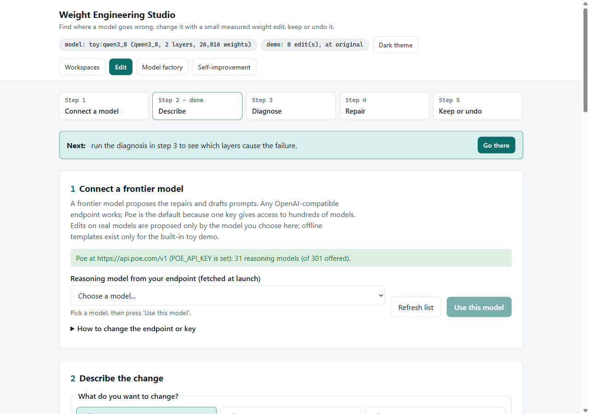
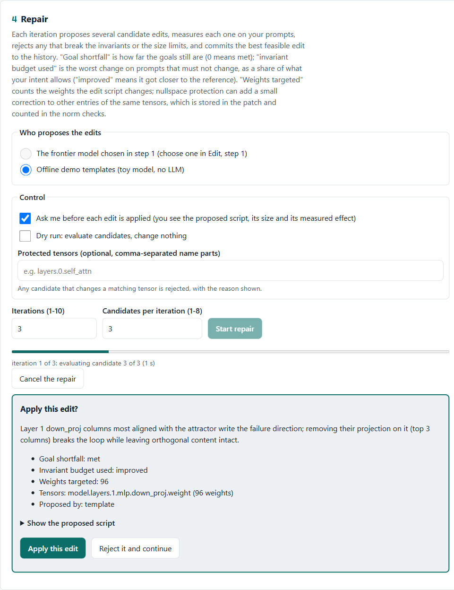
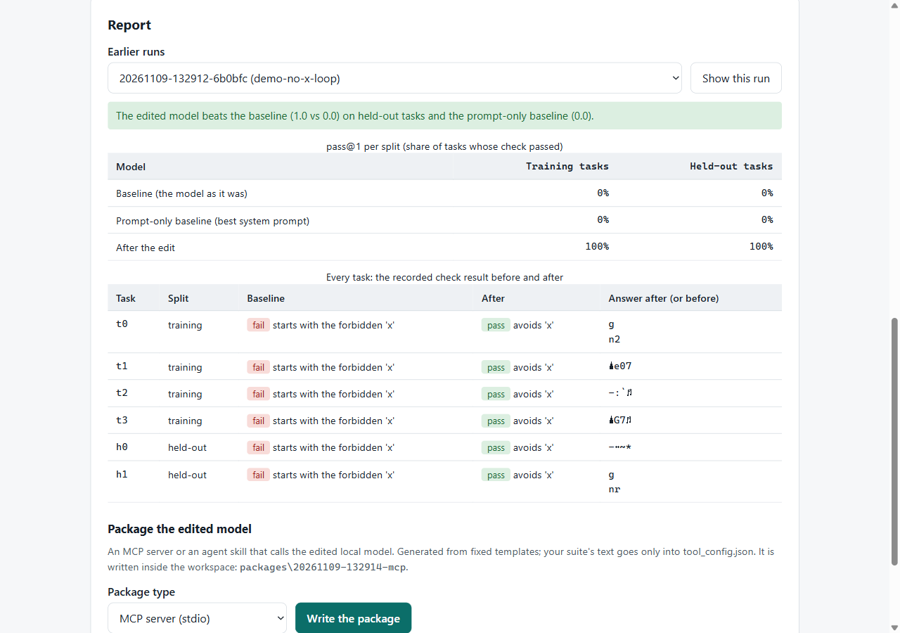
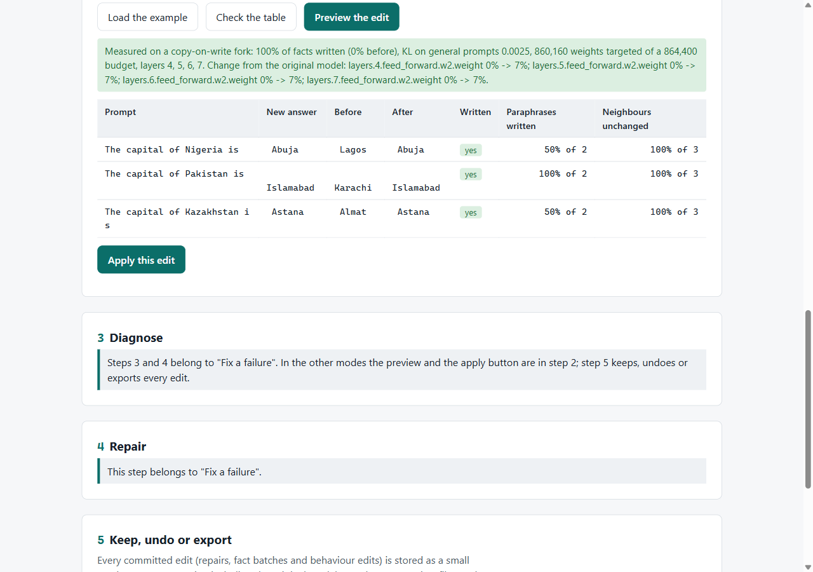

# Weight Engineering Suite

Find where a language model goes wrong, repair it with a small, measured weight edit, and keep or undo the edit
exactly. No training run and no gradient descent on the weights: the tool reads the model's weights and activations, proposes surgical
edits, measures every candidate on your prompts, and only commits edits that improve the target without breaking your
limits (drift on protected prompts, size budget, protected directions, spectral checks).

It runs locally. A guided web Studio has four views (Workspaces, Edit, Model factory, Self-improvement); a CLI exposes
the same engine for scripts. Edits on real models are proposed by a frontier model you choose from your endpoint's live
list of reasoning models; any OpenAI-compatible endpoint works, and [Poe](https://poe.com) is the recommended one
because one key reaches hundreds of models. The built-in toy demo also runs offline with deterministic templates.



> Status: alpha (0.2.0). The engine is tested on built-in toy models and, opt-in, on a real LiquidAI LFM 3 1.7B
> checkpoint. Treat edits to real models as experiments: always keep the original (the Studio's "Restore the
> original model" is one click and bit-exact).

## What it does

**Workspaces.** Start the Studio without arguments and pick a workspace you used before, or create one: the built-in
demo, a Hugging Face model (size, bfloat16 memory estimate against your free CPU or GPU memory, licence, pinned
revision and architecture support are shown before anything downloads; only safetensors weights are fetched and every
file's hash is verified; cancel removes partial files), or a model folder you copied into the Studio home. The facts
panel shows family, adapter, layers, parameters, dtype, device, source, revision and licence.

**Edit**, in five steps. Step 2 offers three kinds of change:

| Step | What happens | Where |
| --- | --- | --- |
| 1. Connect | Lists the reasoning models your endpoint offers right now (`GET /models`); the one you pick proposes edits | Studio, `neuroforge models` |
| 2. Describe | Fix a failure (an intent: failing prompts, wanted answers, prompts that must not change), update facts, or adjust a behaviour | Studio editor, `neuroforge draft-intent` |
| 3. Diagnose | Contrastive tracing ranks the layers and weight columns that push the model toward the failure | Studio, `neuroforge probe` |
| 4. Repair | Each iteration proposes candidate edits, measures them (target score, invariant drift, size), rejects unsafe ones; you see the best candidate's script and numbers and approve it before it is applied. Dry runs, protected tensors, live progress and cancel | Studio, `neuroforge loop` |
| 5. Keep or undo | Every edit is a content-addressed sparse patch; compare original and current answers, restore any point exactly, export the result, or (in the Studio) an edit bundle with model card and checksums | Studio, `neuroforge log`, `neuroforge export` |

A "Next" bar always names the one action that makes sense now, and results survive a page reload (labelled with the
version they were measured at).

- **Update facts**: a table of facts (prompt, subject, new answer, old answer, paraphrases, neighbours), typed in a
  form or pasted as CSV. The edit is computed in closed form (AlphaEdit/MEMIT style) over a window of early-middle
  layers, restricted to the weight budget and kept away from the inputs of neighbour and general prompts. The preview
  reports, per fact, whether it is written, paraphrase success and unchanged neighbours, plus KL on general prompts and
  the tensors' drift from the original; the batch is applied as one patch.
- **Adjust a behaviour**: two prompt sets that differ only in a behaviour. The Studio measures how strongly each layer
  carries it, then removes or amplifies that direction in the few columns that write it (a strength slider), with KL
  to the original and the measured shift shown before you apply.



**Model factory.** Define a job as a task suite (Python unit tests or SQL result rows, run in an isolated child
process with no network, or text checks), split into training and held-out tasks. A run measures the baseline and a
prompt-only baseline (the best system prompt), repairs the failing training tasks with the guarded loop, and measures
again; every check result is logged. Held-out tasks are never shown to the proposer. When the edited model beats both
baselines, it can be packaged as an MCP server or an agent skill built from fixed templates.



**Self-improvement.** Repeated edit generations on the workspace's original model with guardrails you set (anchor KL
limit, generation count, protected tensors, a forgetting check on held-out prompts), pause after the current
generation, stop, and a bit-exact rollback with a preview of what changes. A timeline shows every candidate and the
gate and measured value that decided it.

Also included in the CLI: blueprint compilation of tiny models (`neuroforge compile`), spectral health checks
(`neuroforge spectrum`), patch branches and merges (`neuroforge branch`, `neuroforge merge`), model diffing
(`neuroforge diff-models`) and the self-improvement runtime (`wrsi start`).

## Quickstart (about five minutes, CPU is fine)

Requires Python 3.11 to 3.13.

```bash
git clone https://github.com/Guiyom974/Weight-Engineering-Suite.git
cd Weight-Engineering-Suite
python -m venv .venv
source .venv/bin/activate          # Windows PowerShell: .venv\Scripts\Activate.ps1
pip install -e .
neuroforge studio                  # opens http://127.0.0.1:7860/ on the Workspaces view
```

In Workspaces, create the built-in demo (a toy model with a planted repetition loop and a matching intent). The Studio
switches to Edit: run the diagnosis (it finds the planted defect in layer 1, columns 5, 12 and 19), start a repair
with the offline demo templates, and restore the original model afterwards. Then try the Model factory's demo suite
and a self-improvement run on the same workspace.

The CLI path still works: `neuroforge init -w demo --demo` then `neuroforge studio -w demo`. Or run
`scripts/start.sh` (macOS/Linux) or `scripts\start.ps1` (Windows): they create the venv, install, create the demo
workspace and open the Studio. Downloaded models and Studio-created workspaces live in the Studio home
(`WEIGHTLAB_HOME`, default `~/.weightlab`; `neuroforge studio --home DIR` overrides it).

`neuroforge doctor` checks Python, PyTorch, CUDA, your workspace and your LLM endpoint, and tells you what to fix.

## Connect a frontier model (needed to edit real models)

Edits on real checkpoints are proposed only by the frontier model you choose in step 1; the deterministic templates
are limited to the built-in toy models. Any OpenAI-compatible endpoint works. The key is read from an environment
variable and is never stored, logged or shown in the UI.

**Poe (recommended).** Create an API key in your Poe account, then:

```bash
export POE_API_KEY="your-key"      # Windows PowerShell: $env:POE_API_KEY = "your-key"
neuroforge models                  # lists the models available to your key right now
neuroforge studio -w demo          # step 1 shows the same live list in a dropdown
```

**Other endpoints.** Set the base URL and, if the server needs a key, the *name* of the variable holding it:

| Provider | `WEIGHTLAB_LLM_BASE_URL` | `WEIGHTLAB_LLM_KEY_ENV` |
| --- | --- | --- |
| Poe (default) | `https://api.poe.com/v1` | `POE_API_KEY` (default) |
| OpenRouter | `https://openrouter.ai/api/v1` | `OPENROUTER_API_KEY` |
| OpenAI | `https://api.openai.com/v1` | `OPENAI_API_KEY` |
| Ollama (local) | `http://127.0.0.1:11434/v1` | not needed |
| LM Studio (local) | `http://127.0.0.1:1234/v1` | not needed |
| llama.cpp server (local) | `http://127.0.0.1:8080/v1` | not needed |
| vLLM (local) | `http://127.0.0.1:8000/v1` | not needed |

Safety rules built in: the Poe key is only ever sent to `api.poe.com`; for any other host you must name the key
variable explicitly; keys are never sent over plain HTTP to a non-local host. See
[docs/LLM_ENDPOINTS.md](docs/LLM_ENDPOINTS.md).

CLI equivalents: `--reasoner llm --model <id> [--base-url URL] [--key-env NAME]` on `neuroforge loop` and
`neuroforge draft-intent`, and `--proposer llm --proposer-model <id>` on `wrsi start`.

## Real models

```bash
pip install -e ".[hf]"
neuroforge studio      # Workspaces -> New workspace -> A Hugging Face model -> Check the model -> Download and create
```

The check shows the download size, the memory needed to edit (two bfloat16 copies of the weights) against the free
memory of the device you chose, the licence from the model card, the revision it pins and whether an adapter supports
the architecture; for gated models set `HF_TOKEN` (sent only to the Hub, never to its CDN). The CLI equivalent is
`neuroforge init -w qwen --model Qwen/Qwen2.5-0.5B-Instruct@<commit-sha>`.

You then write an intent, facts or a behaviour's prompt sets (step 2). Validate an architecture the way the case below
does before relying on it. Remote code is never executed
(`trust_remote_code=False`); LiquidAI LFM 3 runs through a vendored, reviewed copy of its modeling code. Model
weights are downloaded from Hugging Face under their own licences and are not part of this repository.
Memory: a 1.7B model in bfloat16 needs about 4 GB of RAM or VRAM; edits are evaluated on copies of the touched
tensors only.

## A real case: three outdated capitals in LFM 3 1.7B

Asked 44 factual questions, LiquidAI LFM 3 1.7B gave four clearly wrong answers and one evasive one (greedy answers,
9 November 2026). Three of the wrong ones are former capitals: "The capital of Nigeria is" -> Lagos (capital until 1991), "The capital of Pakistan is" -> Karachi
(until 1959), "The capital of Kazakhstan is" -> Almaty (until 1997). One "Update facts" batch with the default
settings corrected all three:

| Measure | Result |
| --- | --- |
| Facts written | 3 of 3: Abuja, Islamabad, Astana |
| Rewordings the model got wrong before, now right | 4 of 6 ("The capital city of Nigeria is" -> Abuja; the possessive "Nigeria's capital city is" and "Kazakhstan's capital city is" still give the old answer) |
| Neighbour prompts unchanged | 9 of 9, including each country's largest city: still Lagos, Karachi and Almaty |
| KL on general prompts | 0.0025 |
| Weights changed | 860,160 of 1,728,801,536 (0.05%), layers 4 to 7, no limit broken |
| Undo | bit-exact; every answer back to the original |

After the edit the model continues "The capital of Nigeria is Abuja, located in the Federal Capital Territory" and
"The capital of Kazakhstan is Astana (formerly known as Nur-Sultan)". Prompts unrelated to the edit keep their answers
(Paris, Tokyo, Au, Jane Austen), but some longer continuations change after the answer. The recorded preview took 11.6
seconds on a laptop GPU (RTX 5080). Reproduce it with `python examples/lfm3_capitals.py --model <folder> --device cuda`; the
recorded output is in [examples/lfm3_capitals_results/results.md](examples/lfm3_capitals_results/results.md).



The same case in the Studio. The Before and After columns show the model's first answer token, which is why Almaty appears as "Almat".

## How it works

```text
intent.yaml --> probe (contrastive tracing) --> candidate edits (LLM or templates)
                                                     |
                     sandbox: generated scripts run with an allow-listed torch API, cloned inputs, a line budget
                                                     |
                     evaluate on a copy-on-write overlay: target score, KL drift on invariant prompts,
                     sparsity budget, nullspace protection of locked directions, spectral checks
                                                     |
                     best feasible candidate --> .wgit commit (sparse COO patch + manifest of measured metrics)
```

Fact and behaviour edits skip the candidate tournament: they are computed in closed form, measured on the same
copy-on-write overlay and committed as ordinary patches.

Every number shown by the Studio or the CLI is measured on your machine. When the toy templates are used, results and
manifests say "offline demo templates".

## Security model

- The Studio binds to `127.0.0.1`, refuses foreign `Host` and `Origin` headers, sends no CORS headers, and requires
  a per-session token on every state-changing request, so other web pages cannot drive it.
- No HTTP route accepts a file path, URL or code: workspaces and model folders are picked by id from the server's own
  lists; exports go to `<workspace>/exports/` and packages to `<workspace>/packages/`.
- Downloads: https only, safetensors weights only, declared sizes and SHA-256 (or git SHA-1) hashes verified, partial
  files removed on cancel or failure, `HF_TOKEN` never sent to another host.
- LLM-generated edit scripts run in an in-process allow-list sandbox. Model-written code for factory checks runs in a
  `python -I -S` child with an audit hook (no network, subprocesses, native code or writes outside its folder), a
  memory limit and a timeout. Both are strong filters, not operating-system boundaries: run untrusted endpoints and
  suites inside a container. See [SECURITY.md](SECURITY.md).

## Development

```bash
pip install -e ".[dev]"
pytest                       # offline, toy models, about four minutes on CPU
ruff check src tests
mypy src
WEIGHTLAB_REAL_MODEL_DIR=/path/to/LFM3-1.7B pytest -m real_model   # opt-in real-checkpoint tests
```

See [CONTRIBUTING.md](CONTRIBUTING.md) and [docs/GUIDE.md](docs/GUIDE.md).

## Limitations

- Edits are evaluated on the prompts in your intent. A good score there is evidence, not proof, that behaviour
  improved in general: add invariant prompts for anything you must not break.
- The invariant check measures how much the next-token distribution moves (KL), not whole generations. On the toy
  demo the approved edit passes it, yet "Compare answers" shows the protected prompts' 24-token greedy answers
  diverging after their first tokens. Read the compare table before keeping an edit.
- The in-process sandbox cannot cap memory or CPU of native torch kernels.
- GGUF: the Studio does not export GGUF. The CLI's `neuroforge export --format gguf-patch` patches an existing GGUF
  file in place and is experimental; the reliable path is `--format hf` followed by llama.cpp's converter.
- The self-improvement runtime (`wrsi`, Studio view) is experimental; it works on the original model, separately
  from the Edit history, and keeps its own rollback points.
- On the built-in toy models, fact edits that change an answer exceed the safety limits (their blocks write very
  little into the residual stream); the preview measures and explains this and refuses to apply. Use a real model.
- The factory's packaged tools need this package installed to run, and their `tool_config.json` names the local
  model folder on your machine.

## Licence

MIT, see [LICENSE](LICENSE). Third-party code and notices: [THIRD_PARTY_NOTICES.md](THIRD_PARTY_NOTICES.md).
